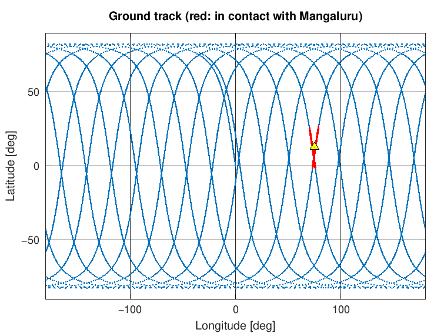
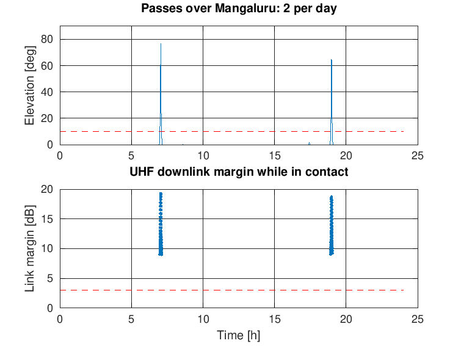
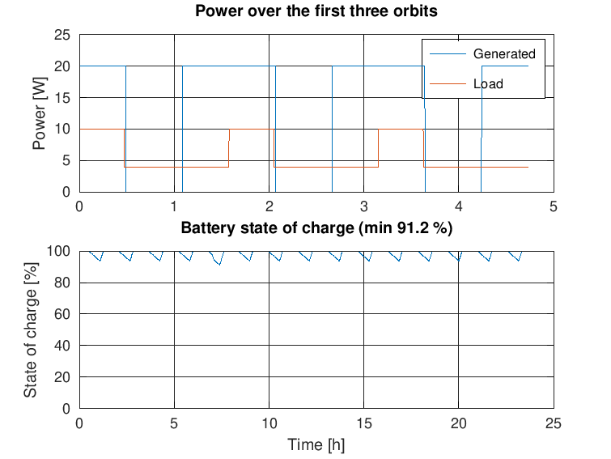
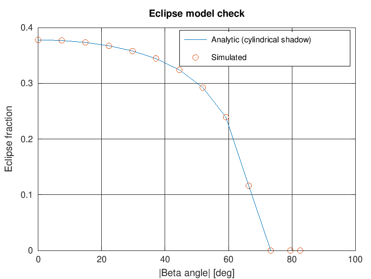

# CubeSat Mission Budget Simulator (MATLAB)

A small MATLAB tool that sizes a 3U CubeSat mission in a 500 km sun-synchronous orbit: orbit and eclipse, ground-station passes over Mangaluru, India, the power and battery budget, and the UHF downlink budget. Plain MATLAB with no toolboxes; it also runs in GNU Octave.

Run `main` in MATLAB from this folder. It prints a summary, writes `results/summary.txt` and saves four figures to `results/`. All parameters are at the top of `main.m`.

## Results (default parameters)

| Budget | Result |
|---|---|
| Orbit | 500 km circular, i = 97.4°, period 94.6 min, beta angle 0° (worst-case eclipse) |
| Eclipse | 37.2 % of the day simulated vs 37.8 % per orbit from the closed form* |
| Contacts (elevation ≥ 10°) | 2 passes per day, 14.5 min total, longest 7.3 min |
| Power | 12.55 W average generation vs 5.94 W average load, margin +6.61 W |
| Battery (40 Wh) | minimum state of charge 91.2 %, maximum depth of discharge 8.8 % |
| UHF link (1 W, 9600 bit/s, 14 dBi Yagi) | margin 9.0 dB at 10° elevation, 19.3 dB at the highest pass |
| Data | 1.04 MB/day downlinked vs 6.48 MB/day generated: only 16 % of payload data returned |

\*The 0.005 gap comes from the one-day run not being a whole number of orbits. Over whole orbits the simulation matches the closed-form eclipse fraction to within 0.0004 across 13 beta angles (`results/eclipse_validation.png`).

**What the budgets say.** Power and the radio link both have healthy margins, but the data budget does not close: with one ground station and a 9600 bit/s UHF link, the satellite returns about a sixth of what its payload produces. The fixes to study next are a faster S-band downlink, more ground stations, or a lower payload duty cycle. Changing `p.data_rate_bps`, `p.payload_duty` or the station location in `main.m` shows the effect immediately.

## Figures

| | |
|---|---|
|  |  |
|  |  |

## How it works

| File | What it does |
|---|---|
| `src/orbit_propagate.m` | Circular two-body orbit in the inertial frame, rotated into the Earth-fixed frame; ground track; beta angle; cylindrical Earth-shadow eclipse model |
| `src/eclipse_fraction_analytic.m` | Closed-form eclipse fraction, used to check the simulation |
| `src/ground_contacts.m` | Elevation and slant range from the ground station; splits the day into passes |
| `src/power_budget.m` | Solar generation vs bus, payload and radio loads; battery state of charge with charge and discharge efficiencies |
| `src/link_budget.m` | EIRP, free-space path loss from the simulated slant range, G/T, Eb/N0 and margin; data volume over usable contact time |

## Assumptions and limits

- Circular orbit, spherical Earth, no J2, drag or other perturbations, so the orbit does not stay sun-synchronous beyond the simulated day.
- The Sun direction is fixed in the inertial frame for the day.
- Panels are assumed Sun-pointing whenever the satellite is in sunlight; no attitude or panel-angle model.
- Power, link and payload values are illustrative 3U CubeSat numbers, not a specific mission.
- Pass counts depend on the start time and longitude of the orbit; a multi-day run would average them out.

## License

MIT
